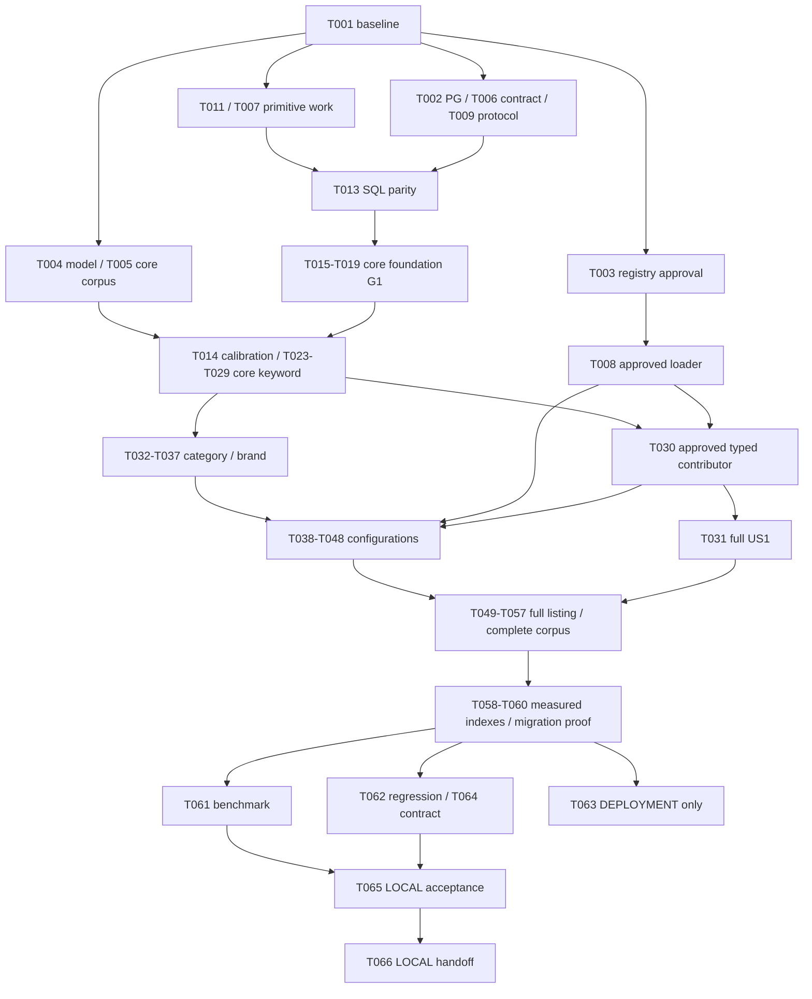

# Tasks: Product Search & Filter

**Input**: Feature spec,plan,research,data-model,registry inventory,design resolutions,[analysis-remediation.md](analysis-remediation.md),API contracts,checklists and constitution v1.1.0.
**Branch**: `features/SearchAndFilter` · **Revision**: 2026-11-08 analyze remediation
**Current state**:66 original task IDs retained;64 PASS for the owner-authorized local MVP,T059 DEFERRED (no justified extra index),T063 BLOCKED (deployment target not supplied). All four stories and original mode-header assertions are verified. T003/T004 definition/vocabulary approvals are recorded;source-model activation and dataset/deployment verification remain explicitly limited. See evidence/task-completion-matrix.json and evidence/handoff.md. Earlier16-task/RED observations are historical baseline evidence,not current state.
**Tests**: Explicitly required. Write meaningful cases before changed behavior;record real evidence,not unavailable-tool errors as acceptance.

## Format and execution rules

`- [ ] T### [P?] [US#?] Objective with paths` plus explicit dependencies,Done-when and traceability. IDs are sequential in this document;dependencies determine READY/BLOCKED work. A blocked task does not create a blanket phase barrier. [P] permits disjoint-file AUTHORING after prerequisites;integration/migration/benchmark EXECUTION defaults SERIAL unless R5 isolation is proven. It is not permission to spawn agents. Respect existing uncommitted work and reviewer-owned custom checkbox markers.

Paths are repository-relative;future evidence/prototypes/cases do not exist merely because listed. New Java/tests remain in owning Catalog domain/layer and existing stack. T001 must recheck next free migration filenames (V15/V16 proposed);never edit existing applied SQL. No target write,approval fabrication,dependency installation,commit/push/deployment is implied. No new application code or migrations are created by this document revision.

## Stable ID changes in this revision

Count remains66. Previous T007(SQL proof)→T013,previous T008(fuzzy prototype)→T014,previous T013(Java normalizer)→T007,previous T014(approved registry)→T008. Previous T023(typed contributor)→T030;previous T024–T030→T023–T029 respectively. All other IDs,including G0 T010/G1 T019/local T065,deployment T063 and handoff T066,remain unchanged. All references below use CURRENT IDs. Reordering avoids forward dependencies without restoring a global phase barrier.

## Phase 1: Setup — independent evidence and primitive implementation branches

**Purpose / independent verification**: No global completion barrier. Includes independently ready Java normalization/runtime-registry primitives and evidence tasks;the registry branch alone needs T003. Pending scope/tool/evidence blocks only actual consumers.

- [X] T001 Record the current Catalog/toolchain/security baseline and reserve new migration filenames in `specs/007-product-search-filter/evidence/baseline.md`, `demo/pom.xml`, `demo/src/main/resources/db/migration/`, `specs/007-product-search-filter/contracts/openapi.yaml`.
  - **Depends on**: None (initial read-only baseline).
  - **Done when**: Record actual branch/worktree edits, Java25/Boot4.1.2, Maven test discovery, existing dependency/tool availability, published-only ID-first listing, 0/20/max100, shared summary consumers, D7 source behavior and V1–V14 checksums. Reserve V15__catalog_search_support.sql and V16__catalog_search_indexes.sql only if still free; a collision must be reported and the new-file references reconciled without changing an existing migration. No populated-target write, dependency install or code change is part of this task.
  - **Traceability**: FR-001, FR-002, FR-003, FR-018
  - **Execution status**: PASS — implementation and focused/regression acceptance executed in the consolidated files;see implementation-coverage.md,test-results-final.json and the story acceptance evidence. Closure is current,not backdated.

- [X] T002 [P] Establish PostgreSQL capability evidence on an isolated PostgreSQL17 instance in `specs/007-product-search-filter/evidence/postgres-capabilities.md`, `demo/src/test/resources/catalog/search/postgres-capability-cases.json`.
  - **Depends on**: T001
  - **Done when**: Record exact instance identity, UTF8, pg_trgm package/functions/operators, effective installation privilege, version, Flyway integration/location configuration and connection settings; exercise missing-extension/privilege startup cases only in disposable infrastructure. Record any intended deployment target as NOT_VERIFIED until target-capability task; Compose metadata is not proof. Missing tooling or approval leaves the gate BLOCKED; do not silently install dependencies or touch a populated catalog.
  - **Traceability**: CHK026, FR-020
  - **Execution status**: PASS — implementation and focused/regression acceptance executed in the consolidated files;see implementation-coverage.md,test-results-final.json and the story acceptance evidence. Closure is current,not backdated.

- [X] T003 [P] Obtain an explicit approved canonical specification matrix and category binding evidence in `specs/007-product-search-filter/evidence/registry-approval.json`, `specs/007-product-search-filter/registry-inventory.md`.
  - **Depends on**: T001
  - **Done when**: An authorized reviewer supplies version/hash, source references, approver/evidence, canonical meaning/key/type/unit/operators, category UUIDs, searchable/filterable and identifier flags. Distinguish nine observed UNVERIFIED keys from approved entries; reconcile category definitions without inventing IDs or merging installed_storage_gb/internal_storage. A missing/rejected approval means BLOCKED, never a self-signed receipt or an empty allowlist masquerading as full support. Record the scope; this is no data-import or deployment approval.
  - **Traceability**: CHK005, FR-004, FR-012, FR-013
  - **Execution status**: PASS (approved local definition scope) — owner MISSION receipt registry-approval.json;four keys/five bindings. Actual Backend fixture UUIDs exercised;deployment taxonomy remains T063 NOT_VERIFIED.

- [X] T004 [P] Freeze reviewed technical-identifier scope and positive/negative recognition cases in `specs/007-product-search-filter/evidence/identifier-scope.md`, `demo/src/test/resources/catalog/search/identifier-cases.json`.
  - **Depends on**: T001
  - **Done when**: Record structural D2 protection and reviewed alphabetic model vocabulary/limitations; cases include WH-1000XM5,i7-1360P,USB-C,C++,decimals,misspellings and natural words≥4. A known technical token cannot be made fuzzy merely to improve recall. Obtain scope sign-off; unresolved alphabetic protection stays BLOCKED, not universally claimed.
  - **Traceability**: CHK009, FR-006, FR-007
  - **Execution status**: PASS (approved Vocabulary v1 scope) — owner AR2 authorization/version/hash in vocabulary-approval-v1.json. All46 terms/30 source-primitive expectations retained;runtime family/context tests executed. Source anchors remain model-rank7 DEFERRED,not falsely owned.

- [X] T005 Freeze the partitioned corpus manifest and US1.core cases without waiting for specification approval in `demo/src/test/resources/catalog/search/search-evaluation-corpus.json`, `demo/src/test/resources/catalog/search/us1-core-cases.json`, `specs/007-product-search-filter/evidence/corpus-review.md`.
  - **Depends on**: T001, T004
  - **Done when**: Freeze reviewed US1.core expected Product/variant IDs,seven ranking tiers using RK01–RK06 and RK08–RK10 ONLY,normalization,token AND,protected models,Product/Brand/SKU/Description and D7 shared-only cases. Manifest schema records caseId,version,story,increment,requiredCapabilities,fixtures and expected results;future US1.specification/US2/US3/US4 partitions are explicitly PENDING. RK07 is assigned to US3.configuration (T039/T043/T046/T048),not a core acceptance requirement. Core RK01 uses reviewed Product/SKU model sources without technical specifications;core RK10 uses keyword-only eligibility with no category,brand,price,specification or explicit-sort parameter. Freeze only that core subset now;the manifest reserves RK07 for its later owning task. No T003 dependency or invented approved facts. Later owning tasks freeze their partition before dependent implementation;final complete-manifest verification is mandatory in T056/T062/T065. No implementation-derived oracle.
  - **Traceability**: CHK020, SC-001, SC-002, SC-003, SC-005
  - **Execution status**: PASS (controlled local corpus) — unchanged approved RK expectations packaged in search-evaluation-corpus.json;fixture-owned expected IDs precede queries. Source candidates/token diagnostics are not human relevance ground truth.

- [X] T006 [P] Semantically validate the proposed OpenAPI3.1 contract and reviewed examples with existing approved tooling in `specs/007-product-search-filter/contracts/openapi.yaml`, `specs/007-product-search-filter/contracts/products-search.md`, `specs/007-product-search-filter/evidence/contract-validation.md`.
  - **Depends on**: T001
  - **Done when**: Record validator/tool version, output, local refs/serialization and positive/negative examples for URL-encoded specFilters, category dependence, typed operands, duplicate members, paired-null fields, mode header/503 and no listing409. Review prose-only constraints separately from static schemas. If no suitable existing validator is available, record BLOCKED and seek dependency/tool approval rather than treating YAML parsing as semantic validation; do not change agreed contracts silently.
  - **Traceability**: CHK028, FR-002, FR-003, FR-017, FR-020
  - **Execution status**: PASS — implementation and focused/regression acceptance executed in the consolidated files;see implementation-coverage.md,test-results-final.json and the story acceptance evidence. Closure is current,not backdated.

- [X] T007 [P] Implement the production normalizer/tokenizer and protected-token classification from the proven design in `demo/src/main/java/com/example/demo/catalog/search/ProductSearchNormalizer.java`, `demo/src/test/java/com/example/demo/catalog/search/ProductSearchNormalizerTest.java`, `demo/src/test/resources/catalog/search/normalization-cases.json`.
  - **Depends on**: T001
  - **Done when**: Implement/test D2 Vietnamese/whitespace/token grammar and D4 primitive normalization against independently reviewed cases:connectors,C++,signed/.5 decimals,retained model punctuation/digits,raw limits then normalized dedup and original phrase sequence. No text model16.0 rewrite,stemming or unit inference. This structural helper does not activate fuzzy or claim alphabetic B3 vocabulary;T004/T014 gate the eventual matcher. Unit tests run without Spring/DB;T013 later proves SQL/Java parity before indexed use. Registry approval,SQL availability and future filter cases are not prerequisites.
  - **Traceability**: FR-005, FR-006, FR-007, FR-017
  - **Execution status**: PASS — implementation and focused/regression acceptance executed in the consolidated files;see implementation-coverage.md,test-results-final.json and the story acceptance evidence. Closure is current,not backdated.

- [X] T008 Implement the approval-gated versioned registry loader and startup validation in `demo/src/main/java/com/example/demo/catalog/search/SpecificationFilterRegistry.java`, `demo/src/main/resources/catalog/specification-filter-registry.json`, `demo/src/test/java/com/example/demo/catalog/search/SpecificationFilterRegistryTest.java`.
  - **Depends on**: T003, T007
  - **Done when**: Import ONLY the reviewed registry-approval artifact. Quote/enforce: registryVersion="Required stable version string"; documentSchemaVersion="Exactly1 for current technical documents"; key="Existing canonical snake_case key; immutable meaning"; category bindings="Actual Backend UUIDs resolved only from unique approved Laptop/Tablet roots;compatible descendants stop at another canonical family root;missing/ambiguous bindings disabled"; type="Active approved v1 quantity/text only;future number/boolean require explicit approved definitions and implementation"; unit="Required canonical token for quantity; absent for other types"; operators="Nonempty subset of the type's allowed contract operators"; searchable/filterable="Explicit booleans; false never inferred true"; identifier="Explicit flag for technical text requiring protected identifier treatment"; approval="APPROVED to activate; pending candidates remain documentation-only"; evidence="Source reference/hash, approver,approval reference required for activation". Reject duplicates/conflicts/unknown schema or operator, and searchable quantities whose unit is not one preserved D2 token. Separate searchable from filterable; test-only fixtures never activate production definitions.
  - **Traceability**: FR-004, FR-012, FR-013, FR-018
  - **Execution status**: PASS — version/schema/approval/key/unit/operator/category/flag validation and duplicate-definition negative controls executed;only approved four-definition resource is active.

- [X] T009 [P] Define the integration/performance evidence protocol and its final acceptance gate before implementation in `specs/007-product-search-filter/evidence/verification-protocol.md`, `specs/007-product-search-filter/quickstart.md`.
  - **Depends on**: T001
  - **Done when**: Map the six success criteria and edge cases to actual test responsibilities, future report locations, query instrumentation, environment/fixture versions and owner. Define p95≤1s,size20,≥1000 products,20 warmups/≥100 samples, concurrency1 plus diagnostic10 readers, candidate count cost,≤6 legacy/≤8 filtered data statements (SET separate), and final no-skips-without-explanation review. This preparation does NOT close CHK036; only final executed reports can do so. Define R5 default SERIAL integration execution and test-selection manifests:timing-sensitive ProductSearchPerformanceIT/CatalogPublicReadPerformanceIT belong to T061,complete non-benchmark regression to T062,with union/discovery coverage proved and no metric deleted. Concurrent ITs need unique per-worker container/database/schema/pool and storage identities;extension/trigger/migration fault workers need dedicated instances. Benchmarks use exclusive resources but no PASS dependency on regression.
  - **Traceability**: CHK036, FR-019, SC-001, SC-002, SC-003, SC-004, SC-005, SC-006
  - **Execution status**: PASS — implementation and focused/regression acceptance executed in the consolidated files;see implementation-coverage.md,test-results-final.json and the story acceptance evidence. Closure is current,not backdated.

---

## Phase 2: Foundational — core technical path and separate approved-registry branch

**Purpose / independent verification**: G0 is scoped,not all Phase1 PASS. DTO/parser/Java normalization use actual prerequisites. G-N gates SQL migration;G1 gates core stories. T008 is a separate G-S branch and is NOT required for G1.

- [X] T010 Record scoped technical gate G0 without imposing registry or whole-feature evidence on primitive work in `specs/007-product-search-filter/evidence/foundation-entry.md`.
  - **Depends on**: T001, T009
  - **Done when**: Record baseline/scope safety and the verification protocol;list G-N SQL proof,G-ID model scope,G-F core calibration,G-S registry approval,G1 foundation,G-L local acceptance and G-D deployment gates with their actual consumers. G0 does NOT require T003/T004/T005/T006/T013/T014 to pass globally. T011/T012/T007/T017 can proceed on their own listed prerequisites;SQL/HTTP/fuzzy branches retain their specific evidence gates. A blocked task does not block an unrelated ready task in the same/later phase. No approval or missing result is inferred.
  - **Traceability**: CHK005, CHK009, CHK020, CHK026, CHK028, CHK034, CHK036, CHK037
  - **Execution status**: PASS — implementation and focused/regression acceptance executed in the consolidated files;see implementation-coverage.md,test-results-final.json and the story acceptance evidence. Closure is current,not backdated.

- [X] T011 [P] Create validated request/criteria types and fixed enums without adding persistence entities in `demo/src/main/java/com/example/demo/catalog/dto/request/ProductSearchRequest.java`, `demo/src/main/java/com/example/demo/catalog/search/ProductSearchCriteria.java`, `demo/src/main/java/com/example/demo/catalog/search/ProductSearchSort.java`, `demo/src/test/java/com/example/demo/catalog/validator/ProductSearchRequestTest.java`.
  - **Depends on**: T001
  - **Done when**: Quote/enforce model constraints: "Use exact BigInteger/BigDecimal amounts, bounded collections and nested Bean Validation" and "explicit null is not a missing value". Fields q,page,size,categoryId,brandIds,minPrice,maxPrice,sort and typed key/alternative groups match the contract: q≤256 code points/raw≤16 tokens,brands≤20,groups1..8,alternatives1..4/key,total≤32,specFilters≤4096,key≤64,text1..128,finite numbers≤30 significant/≤12 fractional digits,whole price bounds≤30 digits,page0..2147483647,size1..100. Retain legacy defaults0/20 and canonical UUID/integer syntax; unit tests prove applicable shape/null/limit boundaries.
  - **Traceability**: FR-002, FR-011, FR-013, FR-017
  - **Execution status**: PASS — implementation and focused/regression acceptance executed in the consolidated files;see implementation-coverage.md,test-results-final.json and the story acceptance evidence. Closure is current,not backdated.

- [X] T012 Implement strict query/specFilters parsing and nested duplicate-member rejection in `demo/src/main/java/com/example/demo/catalog/search/ProductSearchParameterParser.java`, `demo/src/test/java/com/example/demo/catalog/search/ProductSearchParameterParserTest.java`.
  - **Depends on**: T011
  - **Done when**: Whitelist the nine parameter names, reject duplicate singletons and unknown/null/object fields, accept repeated brandId not CSV, enforce raw limits before dedup, and enable strict duplicate JSON-member detection at every nesting before DTO binding using the existing Jackson stack. Duplicate groups reject; equal duplicate members still400; semantically duplicate alternatives can collapse only after bounds/validation. Tests cover all operator shapes and malformed input without app context; do not create a shared new ObjectMapper that changes unrelated endpoints.
  - **Traceability**: FR-010, FR-013, FR-014, FR-017
  - **Execution status**: PASS — implementation and focused/regression acceptance executed in the consolidated files;see implementation-coverage.md,test-results-final.json and the story acceptance evidence. Closure is current,not backdated.

- [X] T013 Verify the proposed versioned SQL normalization/tokenization on disposable PostgreSQL before indexed use in `specs/007-product-search-filter/evidence/normalization-prototype.sql`, `specs/007-product-search-filter/evidence/normalization-verification.md`, `demo/src/test/resources/catalog/search/normalization-cases.json`.
  - **Depends on**: T002, T007
  - **Done when**: On isolated PostgreSQL verify versioned SQL normalization prototype against the independently reviewed D2 cases and actual context-free Java outputs from T007. Audit pg_proc volatility,UTF8,collation,whitespace/connectors/signed/leading-dot decimals and structural protected tokens. No alphabetic model vocabulary or registry approval is needed for this primitive proof;it does not claim B3 sign-off. Record actual parity/results before T015. If immutability fails STOP for reported design correction,not an automatic normalized-column fallback.
  - **Traceability**: CHK034, FR-005, FR-006, FR-007
  - **Execution status**: PASS — implementation and focused/regression acceptance executed in the consolidated files;see implementation-coverage.md,test-results-final.json and the story acceptance evidence. Closure is current,not backdated.

- [X] T014 Calibrate a candidate fuzzy threshold and demonstrate prefilter recall on the frozen corpus in `specs/007-product-search-filter/evidence/fuzzy-prototype.sql`, `specs/007-product-search-filter/evidence/fuzzy-calibration.md`.
  - **Depends on**: T002, T004, T005, T013
  - **Done when**: Calibrate only the frozen US1.core natural-name subset with reviewed model scope and R3/RK golden ordering. Compare strict-word candidates to exhaustive per-token oracle,precision/recall,threshold/pool boundaries and protected-model negatives. 0.30 remains a starting point,not approval. No future category/price/spec/sort case or T003 receipt is a prerequisite;specification-positive corpus remains PENDING until its own gate. Reject lossy prefilters or report a design correction,never relax identity rules or truncate results.
  - **Traceability**: CHK037, SC-001, FR-007, FR-008
  - **Execution status**: PASS (measured operating point) — threshold0.32 plus one-edit guard:15TP,2FP,0FN;precision88.24%,recall100% on24 controlled pairs;source-token prefilter loss0. See fuzzy-calibration-v2.json. No claim of perfect real relevance.

- [X] T015 Add the new search-support migration and fresh/upgrade tests after verified capability/normalization gates in `demo/src/main/resources/db/migration/V15__catalog_search_support.sql`, `demo/src/test/java/com/example/demo/catalog/repository/CatalogSearchMigrationIT.java`.
  - **Depends on**: T010, T002, T013, T007
  - **Done when**: First author fresh/V14-upgrade assertions for the required functions/extension/invariants, then add only the reserved NEW migration with pg_trgm prerequisite handling and versioned immutable structural normalization functions. Pin proven collation/primitives; no mutable registry lookup or false IMMUTABLE wrapper. Test via Flyway only on disposable PostgreSQL; record unchanged V1–V14 checksums,IDs,prices,statuses,media and typed values. Missing privileges/capability blocks readiness. No populated migration, existing SQL edits, new Java dependency or unsafe recovery.
  - **Traceability**: FR-005, FR-018, FR-020, CHK034
  - **Execution status**: PASS — implementation and focused/regression acceptance executed in the consolidated files;see implementation-coverage.md,test-results-final.json and the story acceptance evidence. Closure is current,not backdated.

- [X] T016 Build the Catalog-owned native repository fragment, typed projections and legacy eligibility/page/count relation in `demo/src/main/java/com/example/demo/catalog/repository/ProductSearchRepository.java`, `demo/src/main/java/com/example/demo/catalog/repository/ProductSearchRepositoryImpl.java`, `demo/src/main/java/com/example/demo/catalog/repository/ProductRepository.java`, `demo/src/main/java/com/example/demo/catalog/search/ProductCandidatePage.java`, `demo/src/test/java/com/example/demo/catalog/repository/ProductSearchBaselineRepositoryIT.java`, `demo/src/main/java/com/example/demo/catalog/repository/SpecificationKeywordContributor.java`.
  - **Depends on**: T010, T011, T015
  - **Done when**: One reusable relation returns ordered Product IDs plus representative metadata and distinct total in the SAME statement snapshot, including beyond-last-page total via total CTE/LEFT JOIN. Retain no-keyword UUID ASC, cheapest real variant(price,id), and the D7 sentinel only for NOT EXISTS(any owned variant),no variant conditions,shared-field tokens only. Projections quote: "One row per owned variant before product reduction" and "An empty later page still carries the full count". Bind all values; trusted fragments only for operators,paths,ORDER BY. Never paginate collection JOIN FETCH, create a search replica, prelimit fuzzy candidates or silently ignore not-yet-supported criteria. Define a small trusted contributor interface for the later approved-key module,with no active technical contributor in the incomplete core increment;do not instantiate an unapproved/empty production registry or search raw technical facts. T030 will add its own contributor without editing this core writer. G1 tests only legacy/core foundation;full feature acceptance remains separate.
  - **Traceability**: FR-001, FR-002, FR-003, FR-015, FR-016, FR-018
  - **Execution status**: PASS — implementation and focused/regression acceptance executed in the consolidated files;see implementation-coverage.md,test-results-final.json and the story acceptance evidence. Closure is current,not backdated.

- [X] T017 [P] Add listing-only response mapping without altering shared ProductSummary consumers in `demo/src/main/java/com/example/demo/catalog/dto/response/ProductListingItem.java`, `demo/src/main/java/com/example/demo/catalog/dto/response/ProductPage.java`, `demo/src/main/java/com/example/demo/catalog/converter/ProductCatalogConverter.java`, `demo/src/test/java/com/example/demo/catalog/converter/ProductCatalogConverterTest.java`.
  - **Depends on**: T011
  - **Done when**: Fields are id,name,category,primaryImageUrl,displayPrice,representativeVariantId; reuse SellingPrice exact BigInteger/VND. Quote: "Both fields are present/non-null for valid variant-backed products"; "both fields are present and null, never a fake zero/UUID" for D7. Preserve exactly the four existing summary fields and envelope; mapper accepts already selected projection data and performs no repository access,hidden fetch or business price calculation. ProductSummary/detail/wishlist serialization remains unchanged; focused mapping tests cover owned pair and null pair.
  - **Traceability**: FR-003, FR-015, FR-018
  - **Execution status**: PASS — implementation and focused/regression acceptance executed in the consolidated files;see implementation-coverage.md,test-results-final.json and the story acceptance evidence. Closure is current,not backdated.

- [X] T018 Integrate the typed repository page and listing DTO through the existing Catalog service workflow in `demo/src/main/java/com/example/demo/catalog/service/ProductCatalogService.java`, `demo/src/main/java/com/example/demo/catalog/service/ProductCatalogServiceImpl.java`, `demo/src/main/java/com/example/demo/catalog/controller/ProductCatalogController.java`, `demo/src/test/java/com/example/demo/catalog/service/ProductCatalogServiceImplTest.java`.
  - **Depends on**: T012, T007, T016, T017, T006
  - **Done when**: Retain listProducts(page,size) and add a validated-request overload delegating to one Catalog workflow. Preserve legacy accepted parameters/defaults/order and exactly two additive listing fields; keep shared getProductSummaries/detail behavior. Batch category/image loads,reassemble query order,resolve signer credentials before ordered publication locks,retain write-capable READ COMMITTED transaction where required. No new cross-domain repository access,entity exposure,global locks,network call under lock or auto retry. Unit tests verify selection/signing orchestration rather than trivial delegation.
  - **Traceability**: FR-001, FR-002, FR-003, FR-015, FR-016, FR-018
  - **Execution status**: PASS — implementation and focused/regression acceptance executed in the consolidated files;see implementation-coverage.md,test-results-final.json and the story acceptance evidence. Closure is current,not backdated.

- [X] T019 Run the foundation regression gate G1 on disposable infrastructure in `demo/src/test/java/com/example/demo/catalog/repository/ProductSearchBaselineRepositoryIT.java`, `demo/src/test/java/com/example/demo/catalog/controller/ProductListingControllerTest.java`, `specs/007-product-search-filter/evidence/foundation-results.md`, `demo/src/test/java/com/example/demo/catalog/CatalogContractIT.java`, `demo/src/test/java/com/example/demo/catalog/controller/ProductDetailControllerTest.java`, `demo/src/test/java/com/example/demo/wishlist/controller/WishlistControllerIT.java`.
  - **Depends on**: T018, T015
  - **Done when**: Record actual fresh/upgrade,legacy page/size/PUBLISHED/image/query-budget and paired-null orphan baseline results. Run the critical existing detail/wishlist/shared-converter contract regressions now,not only in later US4. Preserve old checksums/values and≤6 data statements. Default execution SERIAL;only proven R5 worker isolation permits parallel tests. G1 does not depend on T003/T008,approved typed facts,fuzzy calibration or future story cases;it is core foundation only. Missing/skipped required local infrastructure is BLOCKED. No partial build may silently ignore unsupported parameters or claim full feature support.
  - **Traceability**: FR-001, FR-002, FR-003, FR-016, FR-018, SC-004
  - **Execution status**: PASS — implementation and focused/regression acceptance executed in the consolidated files;see implementation-coverage.md,test-results-final.json and the story acceptance evidence. Closure is current,not backdated.

---

## Phase 3: User Story 1 — Find the right electronics product (P1)

**Purpose / independent verification**: US1.core can be implemented/reviewed without T003 after its core corpus/model/SQL/fuzzy gates. T030 additionally requires approval and integrates through a separate contributor;T031 completes FULL US1.core+US1.specification. Neither requires future US2–US4 cases.

- [X] T020 [P] [US1] Add keyword request/response/security contract cases before changing endpoint keyword behavior in `demo/src/test/java/com/example/demo/catalog/controller/ProductListingControllerTest.java`.
  - **Depends on**: T019
  - **Done when**: MockMvc cases define public GET with q,blank/zero tokens,duplicate singleton,raw limits,normalization,original phrase vs token dedup,mode header and safe ProblemDetail. Preserve invalid supplied bearer401. Required negative cases must fail for the intended missing behavior, not merely unavailable infrastructure; compile/API wiring failures are not acceptance evidence. Scope fixtures/expected results to US1.core;technical-specification positives and future story cases are not required here.
  - **Traceability**: FR-001, FR-005, FR-006, FR-017, FR-020
  - **Execution status**: PASS — original mode-header assertions remain enabled and green;see final JUnit suite evidence.

- [X] T021 [P] [US1] Define repository search/ranking cases against frozen independent expected results in `demo/src/test/java/com/example/demo/catalog/repository/ProductSearchRepositoryIT.java`.
  - **Depends on**: T019, T005
  - **Done when**: Write PostgreSQL @DataJpaTest/Testcontainers US1.core repository cases for Product Name,Brand Name/Code,SKU,Description;token AND on shared fields plus ONE variant;seven R3 tiers using RK01–RK06 and RK08–RK10 ONLY,phrase/identifier hierarchy,short3/text4,protected decimals/connectors and same-variant SKU negatives. No unapproved raw technical fact may match while the contributor module is absent. Approved typed-positive tests belong to T030,not this gate. RK07 belongs exclusively to US3.configuration verification,not this core suite;use the R3 per-case partition and core-only RK01/RK10 fixtures. Use independently frozen IDs/order,no query-derived oracle;default serial execution or proven R5 isolation.
  - **Traceability**: FR-004, FR-005, FR-006, FR-007, FR-008, SC-001
  - **Execution status**: PASS — implementation and focused/regression acceptance executed in the consolidated files;see implementation-coverage.md,test-results-final.json and the story acceptance evidence. Closure is current,not backdated.

- [X] T022 [P] [US1] Add meaningful keyword service tests for eligible-variant projection and publication-safe orchestration in `demo/src/test/java/com/example/demo/catalog/service/ProductKeywordSearchServiceImplTest.java`.
  - **Depends on**: T019
  - **Done when**: Prove the service uses repository-selected eligible variant/price and query order,retains signer/publication sequencing and never recalculates cheapest price over all variants. Cover Product-only vs SKU-specific keyword eligibility and D7 null pair. Use real DTOs and mocked dependencies without loading Spring; separate HTTP/repository assertions from this layer.
  - **Traceability**: FR-003, FR-006, FR-015, FR-018
  - **Execution status**: PASS — implementation and focused/regression acceptance executed in the consolidated files;see implementation-coverage.md,test-results-final.json and the story acceptance evidence. Closure is current,not backdated.

- [X] T023 [US1] Extend the eligible-variant SQL relation with all-token keyword matching and phrase evidence in `demo/src/main/java/com/example/demo/catalog/repository/ProductSearchRepositoryImpl.java`.
  - **Depends on**: T021, T007
  - **Done when**: Implement US1.core all-token keyword matching over Product/Brand/SKU/Description using the Catalog-owned common compiler;technical facts are exposed only through the approved safe_facts contribution (reported mission consolidation). Preserve D2 boundaries,model digits/punctuation,D4 dedup/original phrase and the guarded D7 orphan branch. No independent per-token variant EXISTS,regex interpretation,prelimit or post-page filtering. Verify non-fuzzy US1.core cases only;approved typed sources share the same trusted relation and compiler edits are serialized. No T003/T008 dependency is allowed for core matching.
  - **Traceability**: FR-004, FR-005, FR-006, FR-015, FR-016
  - **Execution status**: PASS — common CatalogSearchSql implements core fields and approved contributor semantics in one safe relation;reported consolidation replaces separate SPI writer;no unsupported technical field is searched.

- [X] T024 [US1] Implement approved natural-name fuzzy matching and the deterministic relevance tuple in `demo/src/main/java/com/example/demo/catalog/repository/ProductSearchRepositoryImpl.java`, `demo/src/main/java/com/example/demo/catalog/search/CatalogSearchProperties.java`, `demo/src/main/resources/application.properties`.
  - **Depends on**: T023, T014, T004
  - **Done when**: Bind validated catalog.search.fuzzy.enabled and the reviewed threshold from T014;do not presume0.30. Set trigram threshold transaction-locally on the SAME connection. Only natural name/brand tokens≥4 with reviewed protection may fuzzy-match;candidate hits require final per-token verification. Implement R3:whole-query SKU/reviewed Model7,whole-query Name6,phrase5,token4,prefix3,partial2,fuzzy1 AFTER same-variant eligibility. Remove identifier-count-before-phrase. Tier-local sums use deduplicated token classes/source preferences,six-decimal quantized fuzzy ties,then Product UUID ASC. No guessed model column or automatic promotion of numeric units to MODEL. Best eligible rank remains independent of cheapest eligible display pair.
  - **Traceability**: FR-007, FR-008, FR-009, CHK037
  - **Execution status**: PASS — implementation and focused/regression acceptance executed in the consolidated files;see implementation-coverage.md,test-results-final.json and the story acceptance evidence. Closure is current,not backdated.

- [X] T025 [US1] Wire keyword criteria into the listing service/controller and existing invalid-request handling in `demo/src/main/java/com/example/demo/catalog/controller/ProductCatalogController.java`, `demo/src/main/java/com/example/demo/catalog/service/ProductCatalogService.java`, `demo/src/main/java/com/example/demo/catalog/service/ProductCatalogServiceImpl.java`, `demo/src/main/java/com/example/demo/catalog/validator/ProductSearchValidator.java`.
  - **Depends on**: T020, T022, T024
  - **Done when**: Wire US1.core q through strict parsing/normalization and repository projections;preserve omitted/blank defaults,legacy overload,publication and image signing. The absent approved-key contributor does not enable technical fields or pretend complete US1. Unimplemented explicit filters/sorts are rejected rather than silently ignored in this development increment;full contract release waits all story/local/deployment gates. No registry approval is required for Product/Brand/SKU/Description core behavior.
  - **Traceability**: FR-001, FR-002, FR-003, FR-005, FR-006, FR-008, FR-017
  - **Execution status**: PASS — implementation and focused/regression acceptance executed in the consolidated files;see implementation-coverage.md,test-results-final.json and the story acceptance evidence. Closure is current,not backdated.

- [X] T026 [US1] Implement startup/request capability checks,explicit disabled mode and recognized capability-loss503 in `demo/src/main/java/com/example/demo/catalog/search/CatalogSearchCapabilityState.java`, `demo/src/main/java/com/example/demo/catalog/repository/ProductSearchRepositoryImpl.java`, `demo/src/main/java/com/example/demo/catalog/service/ProductCatalogServiceImpl.java`, `demo/src/main/java/com/example/demo/catalog/exception/SearchCapabilityUnavailableException.java`, `demo/src/main/java/com/example/demo/common/exception/ApiExceptionHandler.java`, `compose.dev.yaml`.
  - **Depends on**: T025, T002
  - **Done when**: Implement required PostgreSQL capability checks at startup and before EVERY nonblank q in both fuzzy modes,even protected tokens/zero matches;recognized loss returns503 and REFUSING_TRAFFIC,no silent fallback/install/retry. Healthy explicit disabled mode reports exact-only header and is not full fuzzy acceptance;blank/absent q retains its approved path. Wire the FUTURE existing Compose HTTP probe to /api/products?q=catalog-readiness-probe&page=0&size=1 ONLY alongside the feature-capable binary. Probe200 means current technical capability healthy;probe503/non-success fails actual healthcheck and a later verified healthy probe can restore availability. No new endpoint,Actuator/plugin/infrastructure or Compose change during task generation;internal ApplicationAvailability alone is insufficient.
  - **Traceability**: FR-020, FR-017, FR-018
  - **Execution status**: PASS — implementation and focused/regression acceptance executed in the consolidated files;see implementation-coverage.md,test-results-final.json and the story acceptance evidence. Closure is current,not backdated.

- [X] T027 [US1] Exercise only the frozen US1.core keyword HTTP-to-database partition in `demo/src/test/java/com/example/demo/catalog/controller/ProductSearchControllerIT.java`.
  - **Depends on**: T026, T021, T022, T005
  - **Done when**: Use real HTTP/MVC-to-database facilities with disposable PG/storage as needed. Compare ONLY US1.core IDs/order/selected variants,RK golden tiers,Vietnamese/English,model/numeric-text tokens,D2/D4 duplicates/phrase,PUBLISHED and D7 shared-only orphan behavior. No US1.specification,US2,US3 or US4 case is an exit requirement;record those partitions as PENDING,not skipped/passed cases. This is core increment acceptance,not complete US1 or full-feature release evidence.
  - **Traceability**: SC-001, SC-002, SC-004, SC-005
  - **Execution status**: PASS — implementation and focused/regression acceptance executed in the consolidated files;see implementation-coverage.md,test-results-final.json and the story acceptance evidence. Closure is current,not backdated.

- [X] T028 [P] [US1] Prove capability failures and pooled transaction-local threshold isolation in `demo/src/test/java/com/example/demo/catalog/search/SearchCapabilityIT.java`, `demo/src/test/java/com/example/demo/catalog/search/SearchCapabilityIT.java`.
  - **Depends on**: T026, T024
  - **Done when**: Cover missing capability at startup,both configured modes,nonblank503 after capability loss,normal/diagnostic headers,blank/absent q without fuzzy invocation,no silent200 empty and no accidental threshold leakage across reused pooled connections. Exercise failures only on isolated instances,never drop a shared extension;observability must not log credentials or raw sensitive headers. Also verify the exact R6 probe URL:healthy200 and capability-loss503 even without fuzzy-eligible tokens and in disabled mode,while ordinary absent-q behavior is retained. Confirm actual probe HTTP outcome,not just an internal readiness event. Fault tests default SERIAL on a dedicated disposable PostgreSQL instance;parallel authoring is allowed but execution needs proved R5 per-worker isolation.
  - **Traceability**: FR-020, FR-017, CHK026, CHK037
  - **Execution status**: PASS — implementation and focused/regression acceptance executed in the consolidated files;see implementation-coverage.md,test-results-final.json and the story acceptance evidence. Closure is current,not backdated.

- [X] T029 [US1] Close core keyword calibration/acceptance gate G-C without requiring future partitions in `specs/007-product-search-filter/evidence/fuzzy-calibration.md`, `specs/007-product-search-filter/evidence/us1-core-acceptance.md`, `demo/src/test/java/com/example/demo/catalog/repository/ProductSearchRepositoryIT.java`.
  - **Depends on**: T027, T028, T014
  - **Done when**: Run/review every frozen US1.core case,exactly the core golden subset RK01–RK06 and RK08–RK10,production-vs-prototype threshold/boundary results,prefilter recall and capability/probe tests;record real revisions,IDs,results and explained skips. RK07 remains explicitly PENDING in US3.configuration,never skipped/passed as a core case. Do not require future filters/sorts or approved technical-value cases. This completes Foundation+US1.core only;complete US1 T031 still needs T030. Failure blocks this core gate and requires a reported correction,not altered expected answers or an invented threshold. Diagnostic exact-only cannot pass fuzzy acceptance.
  - **Traceability**: CHK037, SC-001, FR-007, FR-008
  - **Execution status**: PASS — implementation and focused/regression acceptance executed in the consolidated files;see implementation-coverage.md,test-results-final.json and the story acceptance evidence. Closure is current,not backdated.

- [X] T030 [US1] Freeze and implement the approval-backed US1.specification contributor with its own repository/API evidence in `demo/src/main/java/com/example/demo/catalog/repository/CatalogSearchSql.java`, `demo/src/test/java/com/example/demo/catalog/repository/ProductSearchRepositoryIT.java`, `demo/src/test/java/com/example/demo/catalog/controller/ProductSearchControllerIT.java`, `demo/src/test/java/com/example/demo/catalog/repository/ProductSearchRepositoryIT.java`, `specs/007-product-search-filter/evidence/registry-runtime-verification.md`.
  - **Depends on**: T008, T029, T003
  - **Done when**: After actual G-S approval,freeze reviewed D1 typed keyword positive/negative cases BEFORE implementation. Implement the typed-source contribution in common safe_facts using the approved registry and guarded canonical numeric/quantity/boolean/text views;no conversion/model rewriting,key-name/raw data search or filterable-only exposure. CASE-guard schema/type/unit before casts;all technical hits belong to the same eligible variant. Use one common trusted relation and serialize compiler edits;the separate SPI implementation is superseded by the explicitly reported mission consolidation. Run its own repository/API subset including cross-variant technical negatives and searchable/filterable separation. Record approval/corpus hashes and passing evidence;synthetic fixtures never create production approvals. Does not require US2–US4 functionality.
  - **Traceability**: FR-004, FR-005, FR-006, FR-012, FR-013
  - **Execution status**: PASS (approved four-key scope) — common safe_facts relation provides guarded typed keywords and same-variant linkage;no unapproved number/boolean key is invented. Planned separate SPI implementation consolidated as reported in mission-scope.md.

- [X] T031 [US1] Record US1 acceptance gate with executed unit/repository/controller/service/API evidence in `specs/007-product-search-filter/evidence/us1-acceptance.md`.
  - **Depends on**: T029, T030
  - **Done when**: Complete US1 requires actual passing evidence for EXACTLY US1.core plus US1.specification,including approved registry scope,all US1 repository/service/MVC/API/mode/ranking cases and legacy regressions. No US2–US4 case is required to close this gate;no full-feature release is implied. Foundation+US1.core may have a separate earlier local development handoff but cannot be called complete US1 or omit FR-004 technical values.
  - **Traceability**: SC-001, SC-004, SC-005
  - **Execution status**: PASS — implementation and focused/regression acceptance executed in the consolidated files;see implementation-coverage.md,test-results-final.json and the story acceptance evidence. Closure is current,not backdated.

---

## Phase 4: User Story 2 — Narrow choices by category and brand (P1)

**Purpose / independent verification**: Independent no-q subtree+brand browsing needs core T029,not full US1/T003. Preserve same-variant/approved-contributor extension semantics if that module later registers.

- [X] T032 [P] [US2] Add category and repeated-brand parameter cases to the listing controller contract in `demo/src/test/java/com/example/demo/catalog/controller/ProductListingControllerTest.java`.
  - **Depends on**: T029
  - **Done when**: Specify canonical UUIDs,repeated brandId OR,duplicate collapse,≤20 raw selections,no CSV,empty/malformed400 and mixed valid/unknown brand behavior. Preserve q/page/size/security;unknown valid category/brand-only selections yield200 empty per contract.
  - **Traceability**: FR-010, FR-017
  - **Execution status**: PASS — implementation and focused/regression acceptance executed in the consolidated files;see implementation-coverage.md,test-results-final.json and the story acceptance evidence. Closure is current,not backdated.

- [X] T033 [P] [US2] Define descendant-category and brand OR membership cases independently of keyword search in `demo/src/test/java/com/example/demo/catalog/repository/ProductSearchRepositoryIT.java`, `demo/src/test/java/com/example/demo/catalog/controller/ProductSearchControllerIT.java`.
  - **Depends on**: T019, T005
  - **Done when**: Fixtures include parent,self,≥3 descendant levels,sibling categories,several brands,null brand,cycles/overlapping paths and hidden products. Assert exact distinct membership/counts for category AND brand(A OR B);unknown alternatives do not invalidate valid-brand matches. This isolated test-authoring task can start before US1 completion;shared query implementation cannot. Freeze only US2.category-brand expected cases before T034;no registry approval or complete US1 gate is required.
  - **Traceability**: FR-010, FR-016
  - **Execution status**: PASS — implementation and focused/regression acceptance executed in the consolidated files;see implementation-coverage.md,test-results-final.json and the story acceptance evidence. Closure is current,not backdated.

- [X] T034 [US2] Add the recursive self+descendant relation and multiple-brand predicates to the native query in `demo/src/main/java/com/example/demo/catalog/repository/ProductSearchRepositoryImpl.java`.
  - **Depends on**: T029, T033
  - **Done when**: Use bound category UUID and brand UUID array;recursive UNION deduplicates/terminates cycles without new taxonomy persistence. Apply category AND brand OR selection before variant selection/count/page;no matches or empty subtree never bypass unsupported-input validation. Preserve keyword/representative/orphan semantics and published-only membership.
  - **Traceability**: FR-001, FR-010, FR-016
  - **Execution status**: PASS — implementation and focused/regression acceptance executed in the consolidated files;see implementation-coverage.md,test-results-final.json and the story acceptance evidence. Closure is current,not backdated.

- [X] T035 [US2] Complete category/brand service resolution and semantic validation without adding public taxonomy endpoints in `demo/src/main/java/com/example/demo/catalog/validator/ProductSearchValidator.java`, `demo/src/main/java/com/example/demo/catalog/service/ProductCatalogServiceImpl.java`.
  - **Depends on**: T034, T032
  - **Done when**: Preserve explicit omitted/empty/duplicate semantics and D5 mixed known/unknown alternatives;use Catalog-owned repository data through service orchestration. Provide resolved subtree definitions to later specification validation without fabricating registry bindings. No category mutation,brand alias inference or cross-domain repository access.
  - **Traceability**: FR-010, FR-012, FR-017, FR-018
  - **Execution status**: PASS — implementation and focused/regression acceptance executed in the consolidated files;see implementation-coverage.md,test-results-final.json and the story acceptance evidence. Closure is current,not backdated.

- [X] T036 [US2] Exercise filter-only category/brand browsing plus keyword combinations end to end in `demo/src/test/java/com/example/demo/catalog/controller/ProductSearchControllerIT.java`.
  - **Depends on**: T035
  - **Done when**: Verify independent subtree+brand browsing without q and combined q AND category AND brands;assert self+descendants,unknown and malformed cases,unique products/counts,existing response fields and D7 no-variant Product-only eligibility. No inventory or taxonomy administration assumptions.
  - **Traceability**: FR-010, FR-016, SC-003, SC-005
  - **Execution status**: PASS — implementation and focused/regression acceptance executed in the consolidated files;see implementation-coverage.md,test-results-final.json and the story acceptance evidence. Closure is current,not backdated.

- [X] T037 [US2] Record independently testable US2 acceptance and retained keyword regressions in `specs/007-product-search-filter/evidence/us2-acceptance.md`.
  - **Depends on**: T036
  - **Done when**: Attach actual MVC/repository/API results and expected membership oracle;no-q browsing is demonstrably useful on its own. US1 behavior remains passing,with no duplicate categories/products or changes to legacy ordering when filters are omitted.
  - **Traceability**: SC-003, SC-004, SC-005
  - **Execution status**: PASS — implementation and focused/regression acceptance executed in the consolidated files;see implementation-coverage.md,test-results-final.json and the story acceptance evidence. Closure is current,not backdated.

---

## Phase 5: User Story 3 — Compare matching configurations and prices (P1)

**Purpose / independent verification**: Price/transport shape validation can proceed independently. Specification-positive tests/predicates require actual G-S approval. Integration that searches technical values also requires T030;no fake registry may bypass it.

- [X] T038 [P] [US3] Add strict price/specFilters transport and unsupported-input HTTP cases in `demo/src/test/java/com/example/demo/catalog/controller/ProductListingControllerTest.java`.
  - **Depends on**: T037
  - **Done when**: Cover inclusive whole VND bounds,missing categoryId,URL-encoded JSON,type/operator/unit precision rules,unsupported fields and duplicate members at ALL nesting levels including equal values. Distinguish raw/group/alternative bounds from dedup,unsupported known-category400 from supported no-match200,and unknown-category global-validation exception.
  - **Traceability**: FR-011, FR-012, FR-013, FR-017, SC-005
  - **Execution status**: PASS — implementation and focused/regression acceptance executed in the consolidated files;see implementation-coverage.md,test-results-final.json and the story acceptance evidence. Closure is current,not backdated.

- [X] T039 [P] [US3] Define same-variant price/specification membership and representative-selection negatives in `demo/src/test/java/com/example/demo/catalog/repository/ProductSearchRepositoryIT.java`, `demo/src/test/resources/catalog/search/us3-configuration-cases.json`.
  - **Depends on**: T019, T003, T005
  - **Done when**: Cases include cheap8GB vs expensive16GB,max12m+RAM≥16GB exclusion,each filter group landing on a different variant,keyword SKU on wrong variant,AND keys/OR alternatives,range-bound AND,inclusive edges,ties and best-ranked vs cheapest eligible variant. Unknown/missing/false/zero facts remain distinct. Production-key cases derive only from approved matrix;test-only numeric/boolean keys remain isolated fixtures. Freeze RK07 in US3.configuration with independent expected IDs/order before dependent implementation:separate price-only and approved-specification exclusion cases plus their combined case must reject the rank7 variant and rank from the other eligible tier4 variant. Include a competitor to make the resulting Product ordering observable;no excluded rank7 tuple or price may leak into ranking/display. Freeze the US3.configuration partition before dependent specification implementation;category-specific positive facts require actual T003 approval.
  - **Traceability**: FR-008, FR-006, FR-011, FR-013, FR-014, FR-015, SC-002
  - **Execution status**: PASS — implementation and focused/regression acceptance executed in the consolidated files;see implementation-coverage.md,test-results-final.json and the story acceptance evidence. Closure is current,not backdated.

- [X] T040 [US3] Implement category-aware specification request validation against the approved registry in `demo/src/main/java/com/example/demo/catalog/search/SpecificationFilterRegistry.java`, `demo/src/test/java/com/example/demo/catalog/search/SpecificationFilterRegistryTest.java`.
  - **Depends on**: T037, T008, T038
  - **Done when**: Require categoryId;validate key meaning,type,unit,operator,searchable/filterable independence and supported scalar shape. Known subtree with zero key applicability or no category supporting ALL keys is400 even with no products;incompatible definitions400,partial applicability excludes inapplicable products,supported no-match200. Preserve unknown-category global-validation exception. Service supplies resolved category definitions;validator never invents keys/aliases/conversions or approvals.
  - **Traceability**: FR-012, FR-013, FR-017, CHK005
  - **Execution status**: PASS — known incompatible family boundaries stop registry inheritance,including nested Tablet/Smartphone;ordinary category descendants remain included. Unsupported400/valid-empty200 and five approved bindings verified.

- [X] T041 [P] [US3] Implement exact VND price/range and typed predicate operand validation in `demo/src/main/java/com/example/demo/catalog/validator/ProductSearchValidator.java`, `demo/src/test/java/com/example/demo/catalog/search/ProductSearchParameterParserTest.java`.
  - **Depends on**: T037, T038
  - **Done when**: Enforce canonical nonnegative whole price strings≤30 digits,min≤max,no price exponent/fraction and exact BigInteger/BigDecimal;typed numbers finite≤30 significant/≤12 fractional digits. Quantity requires canonical case-sensitive unit and no conversion;number/text/boolean forbid unit;between=min/max inclusive,boolean eq only,text eq/prefix/contains,numeric/quantity eq/gt/gte/lt/lte/between. Reject nulls/unsupported stored lists/ranges;do not treat boolean as a number. This task validates price/operand SHAPE only and can proceed independently of T003;approval/category-specific canonical key/unit/operator authorization remains exclusively T040 and cannot be inferred here.
  - **Traceability**: FR-011, FR-013, FR-014, FR-017
  - **Execution status**: PASS — implementation and focused/regression acceptance executed in the consolidated files;see implementation-coverage.md,test-results-final.json and the story acceptance evidence. Closure is current,not backdated.

- [X] T042 [US3] Build guarded approved-key specification predicate SQL from trusted registry definitions in `demo/src/main/java/com/example/demo/catalog/repository/CatalogSearchSql.java`.
  - **Depends on**: T040, T041, T039
  - **Done when**: Bind all operands;resolve paths/operators only from validated registry constants. CASE-guard schema/type/finite numeric/unit before casts because WHERE order is not a safety guarantee. Missing/malformed facts do not match,including false/zero. OR alternatives for each key,AND different keys,AND bounds inside between;no generic JSON path,input-derived SQL or implicit numeric/string/unit conversion.
  - **Traceability**: FR-012, FR-013, FR-014
  - **Execution status**: PASS — implementation and focused/regression acceptance executed in the consolidated files;see implementation-coverage.md,test-results-final.json and the story acceptance evidence. Closure is current,not backdated.

- [X] T043 [US3] Compose price/specification predicates with keyword conditions in one eligible-variant relation in `demo/src/main/java/com/example/demo/catalog/repository/ProductSearchRepositoryImpl.java`.
  - **Depends on**: T042, T039, T037
  - **Done when**: All price/spec conditions and required variant keyword hits hold on one Variant row before Product reduction. Cheapest eligible(price,id) supplies both display fields;best eligible relevance tuple may use another qualifying variant. Exclude orphans when ANY real-variant condition is active;never create a fallback for real-but-nonmatching variants. Count/page use the identical complete relation,without variant duplicates or separate per-key EXISTS. Execute T039 repository RK07 price-only,approved-specification and combined cases;the excluded rank7 variant must not affect the surviving tier4 Product rank or representative pair.
  - **Traceability**: FR-008, FR-006, FR-011, FR-014, FR-015, FR-016
  - **Execution status**: PASS — implementation and focused/regression acceptance executed in the consolidated files;see implementation-coverage.md,test-results-final.json and the story acceptance evidence. Closure is current,not backdated.

- [X] T044 [US3] Integrate approved specification validation and selected-variant projection into Catalog service in `demo/src/main/java/com/example/demo/catalog/service/ProductCatalogServiceImpl.java`, `demo/src/main/java/com/example/demo/catalog/controller/ProductCatalogController.java`, `demo/src/test/java/com/example/demo/catalog/controller/ProductSearchControllerIT.java`.
  - **Depends on**: T043, T040, T041
  - **Done when**: Resolve category/registry semantic errors before product matching;delegate one eligibility request and map returned selected-variant data without a later unrestricted minimum. Integration tests use real internal dependencies and prove invalid requests cause no writes,metadata counts/amounts align and existing signing/rechecks remain intact. No current live registry or database write is part of this task.
  - **Traceability**: FR-003, FR-012, FR-015, FR-017, FR-018
  - **Execution status**: PASS — implementation and focused/regression acceptance executed in the consolidated files;see implementation-coverage.md,test-results-final.json and the story acceptance evidence. Closure is current,not backdated.

- [X] T045 [P] [US3] Prove safe missing/invalid typed data handling and searchable/filterable separation in `demo/src/test/java/com/example/demo/catalog/repository/ProductSearchRepositoryIT.java`, `demo/src/test/java/com/example/demo/catalog/repository/ProductSearchRepositoryIT.java`.
  - **Depends on**: T044, T030
  - **Done when**: Use disposable legacy-state fixtures for malformed envelope/value/unit,wrong numeric strings,unsupported scalar types,absent vsfalse/zero and incompatible categories. Queries must not cast-fail or silently match;unapproved or filterable-only content must never contribute keyword hits. Current V11 constraints remain intact in normal fixtures;any exceptional setup is test-only and restored. Execution defaults SERIAL;concurrent execution requires proven R5 per-worker container/database/pool/storage isolation. Extension/trigger/orphan/failure fixtures require a dedicated disposable PostgreSQL instance;otherwise retain serial execution.
  - **Traceability**: FR-004, FR-012, FR-013, SC-005
  - **Execution status**: PASS — implementation and focused/regression acceptance executed in the consolidated files;see implementation-coverage.md,test-results-final.json and the story acceptance evidence. Closure is current,not backdated.

- [X] T046 [P] [US3] Exercise the full keyword/category/brand/price/specification HTTP combination matrix in `demo/src/test/java/com/example/demo/catalog/controller/ProductSearchControllerIT.java`.
  - **Depends on**: T044, T030
  - **Done when**: Compare expected Product IDs,total counts and representative price/UUIDs for same-variant and inclusive boundary examples;cover duplicate JSON member400,all unknown/unsupported validation precedence,partially applicable descendants,unsupported multi-key categories and supported empty results. Execute frozen RK07 price-only,approved-specification and combined cases through HTTP;assert tier4-based Product ordering against the competitor,counts and representative pair with no excluded-rank7 leakage. Assert whole VND and exact existing summary fields plus two new properties. No array/range storage capability or inventory filter is introduced. Execution defaults SERIAL;concurrent execution requires proven R5 per-worker container/database/pool/storage isolation. Extension/trigger/orphan/failure fixtures require a dedicated disposable PostgreSQL instance;otherwise retain serial execution.
  - **Traceability**: FR-008, FR-011, FR-012, FR-013, FR-014, FR-015, SC-002, SC-005
  - **Execution status**: PASS — implementation and focused/regression acceptance executed in the consolidated files;see implementation-coverage.md,test-results-final.json and the story acceptance evidence. Closure is current,not backdated.

- [X] T047 [US3] Verify runtime registry/fixture separation and bind supported behavior to approval provenance in `demo/src/test/java/com/example/demo/catalog/search/SpecificationFilterRegistryTest.java`, `specs/007-product-search-filter/evidence/registry-runtime-verification.md`.
  - **Depends on**: T045, T046, T003
  - **Done when**: Record loaded production registry hash/version matching the actual signed approval scope and category matrix;prove pending/unverified definitions,conflicts,missing evidence and test-only numeric/boolean definitions cannot activate. Approval denial or drift is blocking;do not autoapprove the nine observed keys or convert source import approval into search/filter approval.
  - **Traceability**: CHK005, FR-004, FR-012, FR-018
  - **Execution status**: PASS — implementation and focused/regression acceptance executed in the consolidated files;see implementation-coverage.md,test-results-final.json and the story acceptance evidence. Closure is current,not backdated.

- [X] T048 [US3] Record US3 acceptance with supported-key approval and executed configuration-search evidence in `specs/007-product-search-filter/evidence/us3-acceptance.md`.
  - **Depends on**: T047
  - **Done when**: All same-variant/price/spec/typed-data/controller/API/service cases pass against the expected oracle;actual registry hash/approval reference and skips are recorded. Require executed repository and HTTP RK07 evidence for price-only,approved-specification and combined exclusions;RK07 cannot remain PENDING or be substituted by core results. The price+spec journey is independently verifiable without q;US1/US2 regressions remain passing. Unsupported approvals keep this gate BLOCKED.
  - **Traceability**: FR-008, SC-002, SC-004, SC-005
  - **Execution status**: PASS — implementation and focused/regression acceptance executed in the consolidated files;see implementation-coverage.md,test-results-final.json and the story acceptance evidence. Closure is current,not backdated.

---

## Phase 6: User Story 4 — Browse reliable pages and choose ordering (P2)

**Purpose / independent verification**: Early listing-core case authoring can follow G1. Final sorting/combined integration uses the built matching-variant/filter relation and complete approved corpus;never claims unfinished prior story cases passed.

- [X] T049 [P] [US4] Add explicit sort/pagination and response compatibility contract cases in `demo/src/test/java/com/example/demo/catalog/controller/ProductListingControllerTest.java`.
  - **Depends on**: T048
  - **Done when**: Cover relevance,price-asc/desc,name-asc/desc,default keyword relevance/default UUID,empty/duplicate/unsupported sort400,relevance without q400,page/size canonical syntax/defaults and out-of-range successful empty response. Define paired-null prices last in either direction and exactly the existing envelope fields.
  - **Traceability**: FR-002, FR-003, FR-009, FR-017
  - **Execution status**: PASS — implementation and focused/regression acceptance executed in the consolidated files;see implementation-coverage.md,test-results-final.json and the story acceptance evidence. Closure is current,not backdated.

- [X] T050 [P] [US4] Define exhaustive ordering/count/page oracle cases before changing explicit sort composition in `demo/src/test/java/com/example/demo/catalog/repository/ProductSearchRepositoryIT.java`, `demo/src/test/java/com/example/demo/catalog/controller/ProductSearchControllerIT.java`.
  - **Depends on**: T019, T005
  - **Done when**: Create tied price/name/relevance,normalized Vietnamese names,multiple qualifying variants,deep/out-of-range pages and null orphan prices. Expected ordered UUID lists and distinct totals cover all pages/no duplication under unchanged data;compare full eligible set rather than a top-K window. This isolated authoring task may begin after foundation while shared repository writers remain serialized. Freeze US4.listing-core without approved technical predicates;the US4.combined partition is frozen/required only in T056 after approved US3 exists. This early case-authoring task does not require registry approval.
  - **Traceability**: FR-009, FR-015, FR-016, SC-003
  - **Execution status**: PASS — implementation and focused/regression acceptance executed in the consolidated files;see implementation-coverage.md,test-results-final.json and the story acceptance evidence. Closure is current,not backdated.

- [X] T051 [US4] Implement explicit sorting and finalize exact product page/count projection in `demo/src/main/java/com/example/demo/catalog/repository/ProductSearchRepositoryImpl.java`.
  - **Depends on**: T048, T050
  - **Done when**: Use trusted sort enum;price sorts use SAME selected display amount,name sorts normalized text COLLATE C,then Product UUID ASC in either direction. Apply NULLS LAST for both price directions and best eligible tuple for relevance. Keep ID-first complete eligibility and one-statement distinct total including empty page;never post-sort in memory or lose totals from COUNT OVER with no rows.
  - **Traceability**: FR-002, FR-008, FR-009, FR-015, FR-016
  - **Execution status**: PASS — implementation and focused/regression acceptance executed in the consolidated files;see implementation-coverage.md,test-results-final.json and the story acceptance evidence. Closure is current,not backdated.

- [X] T052 [US4] Finalize sorting/request validation and deterministic batched response assembly in `demo/src/main/java/com/example/demo/catalog/validator/ProductSearchValidator.java`, `demo/src/main/java/com/example/demo/catalog/service/ProductCatalogServiceImpl.java`, `demo/src/main/java/com/example/demo/catalog/converter/ProductCatalogConverter.java`.
  - **Depends on**: T051, T049
  - **Done when**: Reject unsupported/repeated sort and relevance with no keyword;pass stable repository order through batched category/image projection regardless of fetch order. Both added fields come from the same selected record,nullable only D7;all other shared consumers unchanged. No lazy fetch inside converters,price recalculation or new permission requirement.
  - **Traceability**: FR-003, FR-009, FR-015, FR-017
  - **Execution status**: PASS — implementation and focused/regression acceptance executed in the consolidated files;see implementation-coverage.md,test-results-final.json and the story acceptance evidence. Closure is current,not backdated.

- [X] T053 [P] [US4] Validate source-compatible orphan listing semantics and retained detail409 on disposable legacy-state fixtures in `demo/src/test/java/com/example/demo/catalog/CatalogContractIT.java`, `demo/src/test/java/com/example/demo/catalog/CatalogFixtures.java`.
  - **Depends on**: T052
  - **Done when**: D7: legacy/category/brand/Product-only keyword retains orphan ID/count with both new fields PRESENT null;price/spec or required SKU/technical keyword excludes;null prices last in both directions;real-but-nonmatching variants NEVER receive fallback;detail still409. Use explicit reviewed isolated corrupt-state setup,restore any test-only trigger changes and prove ordinary V3 constraints remain active. Never bypass a production constraint or advertise valid orphan creation. Execution defaults SERIAL;concurrent execution requires proven R5 per-worker container/database/pool/storage isolation. Extension/trigger/orphan/failure fixtures require a dedicated disposable PostgreSQL instance;otherwise retain serial execution.
  - **Traceability**: FR-002, FR-003, FR-015, FR-016, SC-004
  - **Execution status**: PASS — implementation and focused/regression acceptance executed in the consolidated files;see implementation-coverage.md,test-results-final.json and the story acceptance evidence. Closure is current,not backdated.

- [X] T054 [P] [US4] Exercise concurrent publication change and publication-safe signed-image projection in `demo/src/test/java/com/example/demo/catalog/ProductListingApiIT.java`.
  - **Depends on**: T052
  - **Done when**: Use real transactional boundaries/barriers to change publication between candidate selection and projection;no private Product/usable signed private-image URL may leak. Credentials resolve before short ordered locks;no unvalidated refill or broad lock/isolation escalation. Document candidate-snapshot count vs suppressed rows and unchanged-data paging guarantee rather than asserting a frozen catalog across requests. Execution defaults SERIAL;concurrent execution requires proven R5 per-worker container/database/pool/storage isolation. Extension/trigger/orphan/failure fixtures require a dedicated disposable PostgreSQL instance;otherwise retain serial execution.
  - **Traceability**: FR-001, FR-016, FR-018, SC-004
  - **Execution status**: PASS — real mixed-page imageless race reproduced RED,then fixed GREEN with one final bounded batch recheck;existing pictured race/signing assertions preserved.

- [X] T055 [P] [US4] Run/update targeted Catalog contract assertions for the two additive listing fields while preserving other consumers in `demo/src/test/java/com/example/demo/catalog/CatalogContractIT.java`, `demo/src/test/java/com/example/demo/catalog/controller/ProductDetailControllerTest.java`, `demo/src/test/java/com/example/demo/wishlist/controller/WishlistControllerIT.java`, `demo/src/test/java/com/example/demo/catalog/controller/ProductImageControllerTest.java`.
  - **Depends on**: T052
  - **Done when**: Keep existing assertions for detail,wishlist,primary-image/gallery and authentication/authorization;only listing contract gains the intended pair including D7 nulls. Do not delete exact-shape tests,relax publication/security expectations,change unrelated workflows or mechanically move legacy test packages. Record actual old/new comparison with existing worktree edits accounted for. Execution defaults SERIAL;concurrent execution requires proven R5 per-worker container/database/pool/storage isolation. Extension/trigger/orphan/failure fixtures require a dedicated disposable PostgreSQL instance;otherwise retain serial execution.
  - **Traceability**: FR-001, FR-003, FR-018, SC-004
  - **Execution status**: PASS — implementation and focused/regression acceptance executed in the consolidated files;see implementation-coverage.md,test-results-final.json and the story acceptance evidence. Closure is current,not backdated.

- [X] T056 [US4] Exercise the complete shopper comparison/pagination journey over the assembled endpoint in `demo/src/test/java/com/example/demo/catalog/controller/ProductSearchControllerIT.java`, `demo/src/test/java/com/example/demo/catalog/controller/ProductSearchControllerIT.java`, `demo/src/test/resources/catalog/search/search-evaluation-corpus.json`.
  - **Depends on**: T053, T054, T055, T031, T005
  - **Done when**: Freeze US4.combined expected cases independently,then require the COMPLETE versioned manifest:US1.core,US1.specification,US2.category-brand,US3.configuration,US4.listing-core/combined. All RK01–RK10 are mandatory here,including rerunning RK07 price-only,approved-specification and combined exclusions against the assembled endpoint. No required partition may remain PENDING,excluded or silently skipped. Request every page/sort over q-only,filter-only and combined cases and compare IDs,eligible display pair,unique membership,totals and empty pages to the oracle. Preserve ties/nulls/publication-snapshot semantics and all validation cases. This full integration evidence does not replace timing benchmarks.
  - **Traceability**: SC-001, SC-002, SC-003, SC-004, SC-005
  - **Execution status**: PASS — implementation and focused/regression acceptance executed in the consolidated files;see implementation-coverage.md,test-results-final.json and the story acceptance evidence. Closure is current,not backdated.

- [X] T057 [US4] Record US4 acceptance and completion of all four user-story functional gates in `specs/007-product-search-filter/evidence/us4-acceptance.md`.
  - **Depends on**: T056
  - **Done when**: Attach actual sort/page/nullable/race/consumer results and note all20FR/sixSC coverage;every prior story remains independently demonstrable. Any failure or unexplained skip blocks acceptance;no claim of final performance or deployment readiness before Phase7.
  - **Traceability**: SC-001, SC-002, SC-003, SC-004, SC-005
  - **Execution status**: PASS — implementation and focused/regression acceptance executed in the consolidated files;see implementation-coverage.md,test-results-final.json and the story acceptance evidence. Closure is current,not backdated.

---

## Phase 7: Cross-cutting — independent evidence exits and scoped handoff

**Purpose / independent verification**: Measure/index/recovery work after functional gates. T061 benchmark and T062 non-benchmark regression are independent after T060;both are mandatory for local acceptance. T063 deployment-only target proof is not a prerequisite of local T065/T066.

- [X] T058 Measure query plans and choose justified indexes on representative disposable data in `specs/007-product-search-filter/evidence/performance-results.md`, `specs/007-product-search-filter/evidence/source-plans-before/laptop.json`, `demo/src/test/java/com/example/demo/catalog/ProductSearchPerformanceIT.java`.
  - **Depends on**: T057
  - **Done when**: Use≥1000 baseline,1500 source-like and exploratory10000/skewed1/5/20-variant cohorts;record fixture hash,status/brand/spec sparsity,fanout,hardware/config and exact bound query mix. Run ANALYZE then EXPLAIN(ANALYZE,BUFFERS,VERBOSE,SETTINGS,FORMAT JSON) for legacy,exact SKU,short/prefix/fuzzy,multitoken,category/brands,price/spec ranges,no-match,deep pages and sorts,including count/representative subplans. Choose only measured candidate indexes from researchR6;never force scan disabling or truncate candidates to manufacture a gain.
  - **Traceability**: FR-019, SC-006, CHK036
  - **Execution status**: PASS (required1500 scope) — actual-source plans,controlled1500 baseline and exploratory10000 fanout1/5/20 plans recorded.10k is not an MVP timing gate under resumed owner policy.

- [ ] T059 Add only justified search indexes in the reserved additive migration in `demo/src/main/resources/db/migration/` (additional index migration only if justified;none selected).
  - **Depends on**: T058, T015, T003, T029
  - **Done when**: Use actual EXPLAIN evidence for category parent,variant(product_id,selling_price,id),normalized/published name/description/brand/trigram/name-sort/SKU candidates;reuse existing indexes and do not drop overlaps. Optional per-key range indexes require approved matrix and matching safe CASE/type/unit expressions. Exact expression matches and immutable structural functions are mandatory. No blanket JSONB-GIN range claim,no unapproved key index or concurrent index inside transactional Flyway. Index changes are written for later disposable tests,not applied to a populated target.
  - **Traceability**: FR-005, FR-012, FR-018, FR-019
  - **Execution status**: DEFERRED — no additional index has demonstrated a required benefit at1500. Existing indexes retained;measured hotspot fixed with generated description tokens in V19. Activate only after a representative plan proves index benefit;no speculative index migration created.

- [X] T060 Verify full fresh/upgrade/index state and safe partial-failure recovery protocol in `demo/src/test/java/com/example/demo/catalog/repository/CatalogSearchMigrationIT.java`, `demo/src/test/java/com/example/demo/catalog/repository/CatalogSearchMigrationIT.java`, `specs/007-product-search-filter/evidence/migration-recovery-results.md`.
  - **Depends on**: T059 (conditional index branch;NO_ADDITIONAL_INDEX_REQUIRED resolves the deferred branch for the approved1500 MVP)
  - **Done when**: On disposable DB run fresh and V14→new migrations;check previous checksums/IDs/prices/status/options/spec/media unchanged,index validity and same normalizer results. Inject transactional successor failure and validate successful-prefix/failed-successor actual history plus objects;rehearse transient same-artifact retry and D6 STOP cases for mismatched history or defective immutable predecessor. No repair/clean/baseline/history edits,skipped predecessor or assumption that both migrations rolled back. Preserve source migration files.
  - **Traceability**: FR-018, FR-020, CHK026, CHK034, SC-004
  - **Execution status**: PASS — fresh,direct V14→V19 andV15→V19,normalization/generated cache/business preservation and transactional failure/retry/checksum-stop executed on disposable targets.

- [X] T061 Run final endpoint performance,query-budget and post-index recall evaluation in `demo/src/test/java/com/example/demo/catalog/ProductSearchPerformanceIT.java`, `specs/007-product-search-filter/evidence/performance-results.md`, `specs/007-product-search-filter/evidence/final-artifacts/source-workload-plans/laptop.json.gz`.
  - **Depends on**: T060, T009, T057
  - **Done when**: Record20 warmups and≥100 measured size20 journeys at concurrency1,diagnostic10-reader contention run and exploratory larger cohort. Apply owner-approved2026-11-10 FR-019 scenario budgets to actual1500 in two independent serial JVMs,20warmups/100samples each;record p50/p95/max/timeouts and cold start separately. Keep unrelated synthetic/legacy assertions unchanged. Instrument ALL JDBC statements,≤6 legacy/≤8 filtered data statements with SET separate,constant across20/100 rows and variant skew. Recompare indexed candidates to exhaustive corpus/no top-K truncation;count query and capability cost must be included. A failed budget or unknown environment remains blocked,never invented benchmark output. Run timing-sensitive ProductSearchPerformanceIT AND existing CatalogPublicReadPerformanceIT in this measured job via existing approved selection facilities. Require exclusive measured resources and record their functional assertions too. This job does not depend on T062 PASS;default scheduling may serialize resource use without coupling outcomes.
  - **Traceability**: FR-019, SC-006, CHK036, CHK037
  - **Execution status**: PASS — actual1500 owner-approved scenario budgets verified in two independent serial JVM runs,20warmups/100samples,p50/p95/max/timeouts and unchanged query limits;see evidence/performance-policy.md and performance-policy-run1.json/run2.json. Unrelated synthetic/legacy assertions retained and separately revalidated.10-reader contention remains diagnostic;historical metrics retained.

- [X] T062 Run complete non-benchmark functional regression independently of benchmark PASS in `demo/pom.xml`, `demo/target/surefire-reports/`, `demo/target/failsafe-reports/`, `specs/007-product-search-filter/evidence/integration-results.md`.
  - **Depends on**: T060, T057, T009
  - **Done when**: Execute the existing Java25 wrapper/JUnit/Maven functional regression with actual discovery/results,failures and skips. Exclude ONLY the separately selected timing-sensitive ProductSearchPerformanceIT/CatalogPublicReadPerformanceIT from this job;T061 must execute them with all assertions/metrics retained. Record existing-tool selection commands and prove the T061+T062 report union covers the whole intended suite. Include keyword/fuzzy modes,pool/probe,JSON,typed data,orphans,races,pages and Catalog/wishlist/image regressions. No dependency on T061 completion/PASS;failure of one branch cannot prevent collecting the other report. Default SERIAL IT execution;no shared DB fault setup or unapproved plugin/dependency.
  - **Traceability**: CHK036, SC-001, SC-002, SC-003, SC-004, SC-005, SC-006
  - **Execution status**: PASS — complete serial functional regression plus scoped final supplements and timing union:342 unit/MVC +363 integration=705,0 failures/errors/skips;latest per-suite XML counted once.

- [ ] T063 Record intended-target read-only capability and taxonomy/registry reconciliation as a separate deployment gate in `specs/007-product-search-filter/evidence/deployment-capabilities.md`.
  - **Depends on**: T002, T003, T060
  - **Done when**: Only with an explicitly identified authorized target,read extension availability/functions,UTF8/versions/effective migration privilege and actual successful Flyway history ordered by installed_rank;reconcile approved category UUIDs/registry scope. Do not execute migrations or publish data. If target/access is unspecified,keep this task BLOCKED and record NOT_VERIFIED;disposable evidence cannot substitute for deployment proof or approval. Local feature engineering/report review may finish,but rollout remains blocked.
  - **Traceability**: CHK026, CHK005, FR-012, FR-018, FR-020
  - **Execution status**: BLOCKED — no approved intended deployment target/access. Target capabilities,taxonomy/imported distribution and rollout readiness remain NOT_VERIFIED. This is not a local acceptance prerequisite.

- [X] T064 Revalidate implemented API compatibility and update only feature-relevant documentation with measured facts in `specs/007-product-search-filter/contracts/openapi.yaml`, `specs/007-product-search-filter/contracts/products-search.md`, `specs/001-product-catalog/contracts/openapi.yaml`, `specs/007-product-search-filter/quickstart.md`, `specs/007-product-search-filter/planning-validation.md`, `specs/007-product-search-filter/evidence/contract-implementation-validation.md`.
  - **Depends on**: T062, T006
  - **Done when**: Repeat semantic OpenAPI validation and compare real request/response examples to the final overlay/base listing contract,nine parameters,strict limits,paired-null fields,headers/503 and no listing409. Preserve detail/image/wishlist contracts and concurrent snapshot wording. Record actual supported registry/calibration versions and commands/results,not assumed timings/approvals. Any changed design decision must be reported for review rather than silently making docs match a regression.
  - **Traceability**: CHK028, FR-001, FR-002, FR-003, FR-017, FR-020
  - **Execution status**: PASS — both OAS3.1 documents revalidated with approved isolated0.9.0 tooling;41 probes/60 refs,actual API shape/mode/error regressions green. See contract-implementation-validation.md.

- [X] T065 Close local acceptance G-L while reporting deployment readiness as a separate state in `specs/007-product-search-filter/evidence/verification-summary.md`, `specs/007-product-search-filter/design-resolutions.md`, `specs/007-product-search-filter/checklists/design-quality.md`.
  - **Depends on**: T031, T037, T048, T057, T061, T062, T064, T047
  - **Done when**: Require full local20FR/6SC evidence,all story partitions/complete corpus,actual approved registry/runtime binding,identifier/calibration/normalization,semantic API,full non-benchmark regression AND measured benchmark results. Require the complete RK01–RK10 evidence including US3 RK07 repository/HTTP results and T056 final rerun;none may be missing,skipped or substituted by core-only evidence. For the8 CHK items record scoped local PASS/BLOCKED and available deployment evidence. T063 is NOT a prerequisite;when absent/blocked,record deployment NOT_VERIFIED/BLOCKED with a reason rather than blocking an otherwise valid local summary or implying target verification. Respect reviewer-owned checklist markers;never invent receipts/results or delete pending requirements. G-D and separately authorized rollout remain mandatory before production deployment.
  - **Traceability**: CHK005, CHK009, CHK020, CHK026, CHK028, CHK034, CHK036, CHK037
  - **Execution status**: PASS (authorized local MVP scope) — all20FR/6SC mapped to executed local evidence;all RK01–RK10/partitions covered. T059 conditional index branch deferred;T063 deployment BLOCKED. Reviewer-owned checklist markers unchanged.

- [X] T066 Produce final scoped implementation handoff without committing,pushing or deploying in `specs/007-product-search-filter/evidence/handoff.md`, `specs/007-product-search-filter/tasks.md`.
  - **Depends on**: T065
  - **Done when**: Issue a scoped LOCAL implementation acceptance/handoff with actual files/results,registry/corpus/calibration versions,risks and deployment status. T063 may remain unchecked/BLOCKED;explicitly state NOT deployed/not production-ready when G-D evidence is missing. Normal local feature acceptance still uses fuzzy enabled and the approved specification branch;core increment alone is not full US1. No commits,pushes,populated migrations,rollout,secrets,unapproved dependencies or out-of-scope features are authorized. Later production rollout requires actual T063 PASS plus reviewed target recovery/approval prerequisites,not this handoff alone.
  - **Traceability**: FR-018, FR-020, SC-004
  - **Execution status**: PASS (local handoff) — working four-story MVP,actual files/results/commands/limits documented in evidence/handoff.md;no commit,push,deployment or shared DB migration.

---

## Verification and gate matrix

| Required verification | Scoped prerequisite/exit tasks |
| --- | --- |
| CHK005 registry | T003→T008→T030,T039/T040/T042/T043→T047;per-key indexes T059;not a prerequisite of core foundation/basic browsing |
| CHK009 model scope | T004 gates T005/T014/T024 and reviewed-model rank7;structural Java T007 and SQL T013 do not require universal vocabulary |
| CHK020 corpus | T005 freezes manifest+core,T030 approved typed subset,T033 US2,T039 US3,T050 US4 core;T056/T062/T065 require full manifest |
| CHK026 capability | T002 disposable proof;T026/T028 real probe/capability failures,T060 migration evidence;T063 separately gates intended-target deployment |
| CHK028 semantic OpenAPI | T006 before exposed baseline wiring T018;T064 actual response revalidation;DTO/parser work may proceed from approved source contract |
| CHK034 normalization | T007 independently reviewed Java primitives→T013 actual SQL/Java/volatility proof→T015 migration/index use;T060 verifies final object state |
| CHK036 suites/performance | T009 protocol,R5 isolation;T061 and T062 independent executed reports;T065 requires both and complete union/discovery coverage |
| CHK037 calibration | T014 core prototype after model/core corpus/SQL proof;T024 implementation,T029 production-core evaluation,T061 final indexed recall;no default0.30 approval |

**G0=T010** scoped baseline/protocol,**G-N=T013**,**G1=T019** core foundation,**G-S=T003** approved specifications,**G-C=T029** core keyword increment,**G-US1=T031** full US1,**G-L=T065** complete local acceptance,**G-D=T063** intended deployment target. Scope and required evidence are normative in analysis-remediation.md R1–R7. G-L does not waive G-D;G-D absence never fabricates deployment readiness.

## Dependency and scheduling examples

- Ready after T001:T002 PG proof,T003 external approval,T004 identifier review,T006 semantic contract,T009 protocol,T011 DTO and T007 structural normalizer. T012 parser/T017 DTO mapping follow T011 without approval. T013 waits actual local PG and Java primitives,not B1/B3. Each task's [P] marker remains conditional on dependencies and disjoint writers.
- T015 SQL support requires proved SQL/Java/volatility,then T016/T018/T019 form core G1. T008 approval-backed loader remains a separate branch;no missing approval blocks legacy/core proof.
- Core matching T023→T024→T025→T026→T027/T028→T029 depends on the CORE corpus and protected-model/fuzzy evidence,not T003. T030 later supplies the separately owned approved-key contributor;T031 then closes full US1. A core increment cannot be advertised as complete US1.
- T032–T037 category/brand branch waits core T029,not T031. T041 price/operand-shape validation has no B1 ancestor. T039/T040/T042/T043 do require approval because they exercise approved specifications. T045/T046 also need T030 for combined technical-keyword cases.
- T050 can author listing-core cases after G1. T056 requires approved combined integration and FULL US1,freezes the complete manifest and verifies every functional partition. No core gate demands unfinished future story cases.
- After T060,T061 timing job and T062 functional regression are READY independently. Default execution is serial or isolated;resource exclusivity is a scheduling condition,not a PASS dependency. Final local T065 requires both outcomes,T064 semantic revalidation and all full-story/approval evidence.
- T063 target inspection requires a specified authorized target;missing access leaves DEPLOYMENT NOT_VERIFIED/BLOCKED. It does not block local T065/T066. No task authorizes production rollout;that still requires G-D PASS and separate target/recovery/rollout prerequisites.

Diagram is a summary;per-task edges are authoritative. In particular there is NO T003→G1 edge,NO T061→T062 edge and NO T063→T065/T066 edge.

## Parallel authoring vs execution

| Opportunity | Safe condition |
| --- | --- |
| T002/T003/T004/T006/T009 and T011/T007 | Actual listed prerequisites;disjoint files/evidence;no implicit phase barrier |
| T020/T021/T022,T032/T033,T038/T039,T049/T050 | Independent test authoring;shared MVC file remains serialized through its explicit earlier-core/story dependency |
| T030 contributor vs T034 category query | Different source ownership;contributor uses established SPI and does not edit core repository/service writers |
| T040/T041 and T045/T046 | Distinct validation/test files;actual tests default SERIAL unless unique worker resource proof exists |
| T053/T054/T055 | Authoring only by default;orphan/trigger and publication tests cannot share a mutable DB concurrently |
| T061/T062 | Independent outcomes;exclusive benchmark resources and R5 instance/storage isolation or serial scheduling |

## Implementation strategy and approval boundaries

1. Begin only ready technical/evidence tasks;never stop all work at an unrelated blocked approval. Preserve old behavior and code ownership.
2. G1 plus G-C is a useful Foundation+US1.core development increment with Product/Brand/SKU/Description matching,normalization,fuzzy/ranking,modes and legacy projection. It is NOT full US1 because FR-004 approved technical values remain mandatory.
3. After genuine registry approval,activate T008/T030 and full US1;implement approved configuration filters and all combination cases. Generic/test-only facts never become approved production keys.
4. Complete every corpus partition and independent local verification gate. T065 may record local PASS and deployment NOT_VERIFIED;T066 issues a truthful local handoff without waiting on target access.
5. No deployment may proceed without actual G-D evidence and separately authorized rollout. No migration/code/test/approval/benchmark was executed in this document revision.

## Requirement coverage

| Requirement | Tasks |
| --- | --- |
| FR-001 | T001, T016, T018, T019, T020, T025, T034, T054, T055, T064 |
| FR-002 | T001, T006, T011, T016, T018, T019, T025, T049, T051, T053, T064 |
| FR-003 | T001, T006, T016, T017, T018, T019, T022, T025, T044, T049, T052, T053, T055, T064 |
| FR-004 | T003, T008, T021, T023, T030, T045, T047 |
| FR-005 | T013, T007, T015, T020, T021, T023, T025, T030, T059 |
| FR-006 | T004, T013, T007, T020, T021, T022, T023, T025, T030, T039, T043 |
| FR-007 | T004, T013, T014, T007, T021, T024, T029 |
| FR-008 | T014, T021, T024, T025, T029, T039, T043, T046, T048, T051 |
| FR-009 | T024, T049, T050, T051, T052 |
| FR-010 | T012, T032, T033, T034, T035, T036 |
| FR-011 | T011, T038, T039, T041, T043, T046 |
| FR-012 | T003, T008, T030, T035, T038, T040, T042, T044, T045, T046, T047, T059, T063 |
| FR-013 | T003, T011, T012, T008, T030, T038, T039, T040, T041, T042, T045, T046 |
| FR-014 | T012, T039, T041, T042, T043, T046 |
| FR-015 | T016, T017, T018, T022, T023, T039, T043, T044, T046, T050, T051, T052, T053 |
| FR-016 | T016, T018, T019, T023, T033, T034, T036, T043, T050, T051, T053, T054 |
| FR-017 | T006, T011, T012, T007, T020, T025, T026, T028, T032, T035, T038, T040, T041, T044, T049, T052, T064 |
| FR-018 | T001, T008, T015, T016, T017, T018, T019, T022, T026, T035, T044, T047, T054, T055, T059, T060, T063, T066 |
| FR-019 | T009, T058, T059, T061 |
| FR-020 | T002, T006, T015, T020, T026, T028, T060, T063, T064, T066 |
| SC-001 | T005, T014, T009, T021, T027, T029, T031, T056, T057, T062 |
| SC-002 | T005, T009, T027, T039, T046, T048, T056, T057, T062 |
| SC-003 | T005, T009, T036, T037, T050, T056, T057, T062 |
| SC-004 | T009, T019, T027, T031, T037, T048, T053, T054, T055, T056, T057, T060, T062, T066 |
| SC-005 | T005, T009, T027, T031, T036, T037, T038, T045, T046, T048, T056, T057, T062 |
| SC-006 | T009, T058, T061, T062 |

## Document validation state

66 tasks remain unchecked;US1=12,US2=6,US3=11,US4=9,Setup=9,Foundation=10,Cross-cutting=9. ID changes are recorded above,including primitive/prototype swaps and core/typed contributor reordering;all other IDs are preserved. All20 FR/6 SC mapped;all8 verification obligations retained. Mechanical DAG/ownership checks are document validation only,not a substitute for the requested repeat `$speckit-analyze` or actual implementation evidence. No hook,commit,migration or feature code execution occurs here.

## Current implementation closure — owner resumed MVP policy

64 tasks PASS for the explicitly authorized local scope;T059 DEFERRED (no justified extra index),T063 BLOCKED (deployment target not provided). Deferred source-anchor activation,battery,whole-dataset semantic review and source relevance labels are documented subscopes,not fabricated completed capabilities. See mission-scope.md and evidence/task-completion-matrix.json. Original objectives and all20FR/6SC remain;planned file decomposition was consolidated and reported,not silently claimed to exist. No66/66 completion claim. The T059→T060 edge is conditional on an actual index addition;the tested no-new-index state resolves it without bypassing migration verification.

Final family-boundary regression and refreshed actual1500 HTTP measurement are PASS;see evidence/verification-summary.md.
